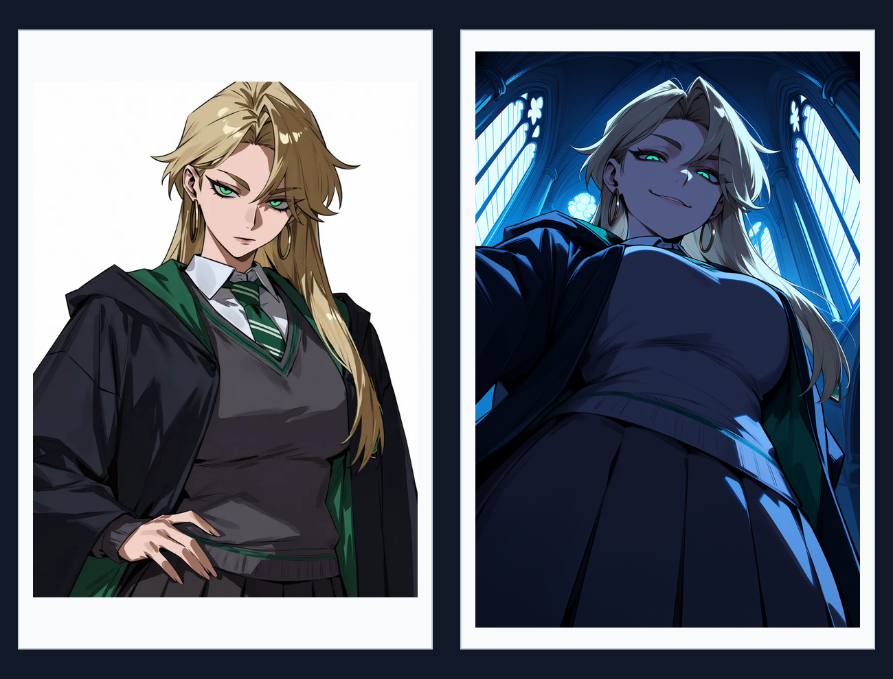
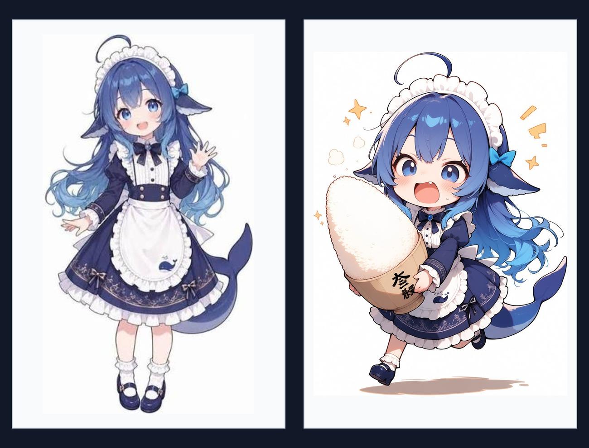
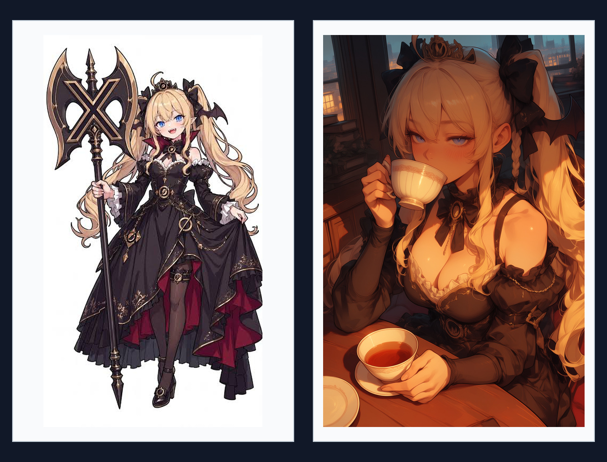
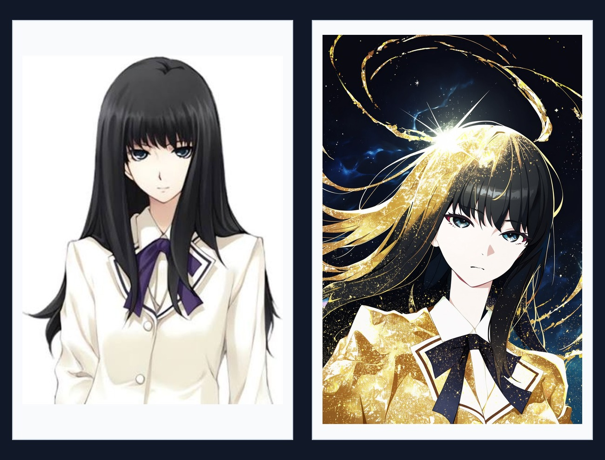
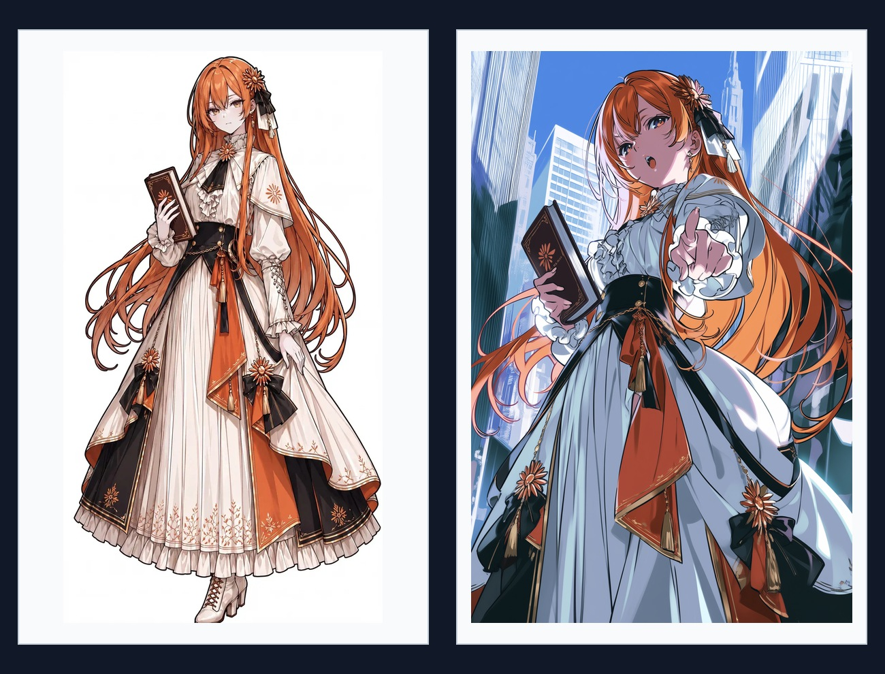
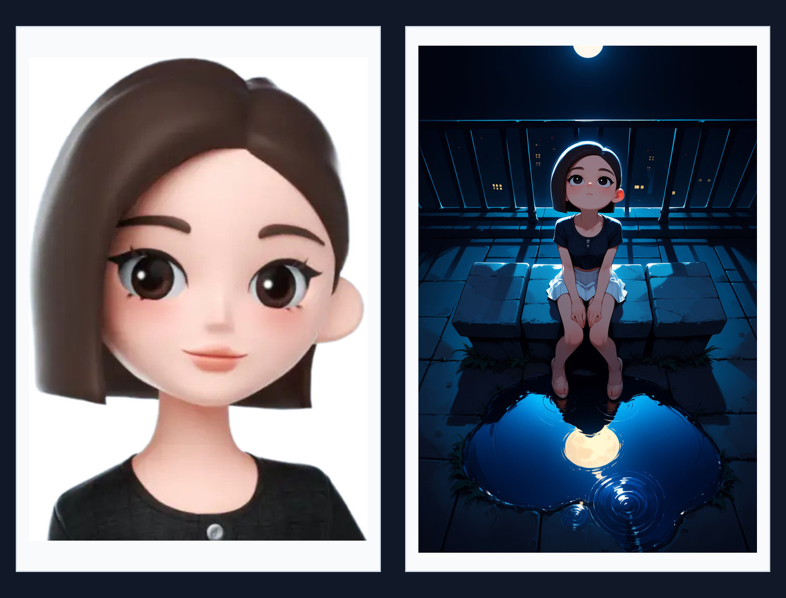

# ComfyUI Anima OmniCharacter

[简体中文](README.zh-CN.md) · [Hugging Face model](https://huggingface.co/Einnashe07/Anima-OmniCharacter)

A ComfyUI custom node for applying Anima OmniCharacter control LoRAs to an Anima
generation workflow.

The node adds a reference-image branch to Anima self-attention, while applying
the control-only LoRA only to that branch. Reference projections are cached
during one sampler call to avoid recomputing them at every denoising step.

## Features

- One-node integration with a standard Anima workflow
- Positive and negative conditioning support
- LoRA discovery through ComfyUI's model paths
- Reference-image encoding through the selected VAE
- Optional reference K/V caching
- Validation for Anima models and control-routed LoRAs

## Installation

Clone or copy this repository to:

```text
ComfyUI/custom_nodes/ComfyUI-Anima-OmniCharacter
```

Repository:

```text
https://github.com/Einnashe/ComfyUI-Anima-OmniCharacter
```

Restart ComfyUI after installation. This node currently has no additional
Python package requirements beyond ComfyUI and its PyTorch environment.

The implementation relies on recent Anima, model-wrapper, and weight-adapter
APIs in ComfyUI. Update ComfyUI if the node fails during import.

## Model files

Download [anima_omnicharacter.safetensors](weights/anima_omnicharacter.safetensors)
and place it in `ComfyUI/models/loras` or another registered LoRA directory.
Get the Anima base model, text encoder, and VAE separately.

The example workflow uses the following filenames:

```text
ComfyUI/models/diffusion_models/anima_baseV10-mid_2458426-vid_2945208.safetensors
ComfyUI/models/text_encoders/qwen_3_06b_base.safetensors
ComfyUI/models/vae/qwen_image_vae.safetensors
ComfyUI/models/loras/anima_omnicharacter.safetensors
```

Keep `anima_omnicharacter` in the LoRA filename so it appears in the node
selector. All LoRAs loaded by this node are treated as control-only adapters;
no routing metadata is required.

## Example workflow

Import [`examples/anima_omnicharacter.json`](examples/anima_omnicharacter.json) into ComfyUI.
Select your own reference image in `Load Image`, and adjust model filenames if
your local files use different names.

The workflow contains:

1. Anima UNet, Qwen text encoder, and Qwen Image VAE loaders
2. Positive and negative text conditioning
3. `Apply Anima OmniCharacter`
4. A standard `KSampler`, VAE decode, and preview

## Prepare the reference image

- Use one reference image with **one character**. Crops from a head close-up
  through a full-body view are supported.
- Remove the original background and use a **white background** before
  loading the reference in `Load Image`.

## Artist tags and style LoRAs

- **Artist tags (partial support):** Add `@artist name` to the positive prompt.
  The effect varies with the tag and reference image. See the
  [Anima prompting guide](https://huggingface.co/circlestone-labs/Anima#artist-tags).
- **Optional style LoRAs:** The example workflow loads only the OmniCharacter
  reference LoRA. To use your own Anima-compatible style LoRA, add
  `Load LoRA (Model Only)` before `Apply Anima OmniCharacter`. You can also use
  an artist tag alongside it.

## Showcase

Each card shows the reference image on the left and the image generated with
Anima OmniCharacter on the right.

<table>
  <tbody>
    <tr>
      <td width="50%" align="center"><br><sub>Example 01 · Reference → Generated</sub></td>
      <td width="50%" align="center"><br><sub>Example 02 · Reference → Generated</sub></td>
    </tr>
    <tr>
      <td width="50%" align="center"><br><sub>Example 03 · Reference → Generated</sub></td>
      <td width="50%" align="center"><br><sub>Example 04 · Reference → Generated</sub></td>
    </tr>
    <tr>
      <td width="50%" align="center"><br><sub>Example 05 · Reference → Generated</sub></td>
      <td width="50%" align="center"><br><sub>Example 06 · Reference → Generated</sub></td>
    </tr>
  </tbody>
</table>

## Node inputs

| Input | Description |
| --- | --- |
| `model` | Anima diffusion model |
| `positive` | Positive conditioning |
| `negative` | Negative conditioning |
| `vae` | VAE used to encode the reference image |
| `reference_image` | Reference image |
| `lora_name` | Anima OmniCharacter control-only LoRA |
| `strength` | LoRA strength |
| `cache_reference_kv` | Cache reference K/V for speed; enabled by default |

The node returns the patched model and updated positive/negative conditioning
for connection to `KSampler`.

## Reference cache

`cache_reference_kv` is enabled by default:

- **cached:** computes the reference branch once, caches one K/V pair per
  transformer block, and reuses it for the rest of the sampler call.
- **uncached:** recomputes the reference branch on every denoising step and
  releases each block's K/V immediately after use.

The cache is local to one sampler invocation. It is cleared in a `finally`
block on normal completion or error, and it is never stored in a module-level
global.

## License and credits

The OmniCharacter LoRA weights are derived from Anima and are subject to the
[CircleStone Labs Non-Commercial License](https://huggingface.co/circlestone-labs/Anima/blob/main/LICENSE.md).

The implementation is inspired by
[OminiControl](https://github.com/Yuanshi9815/OminiControl).
