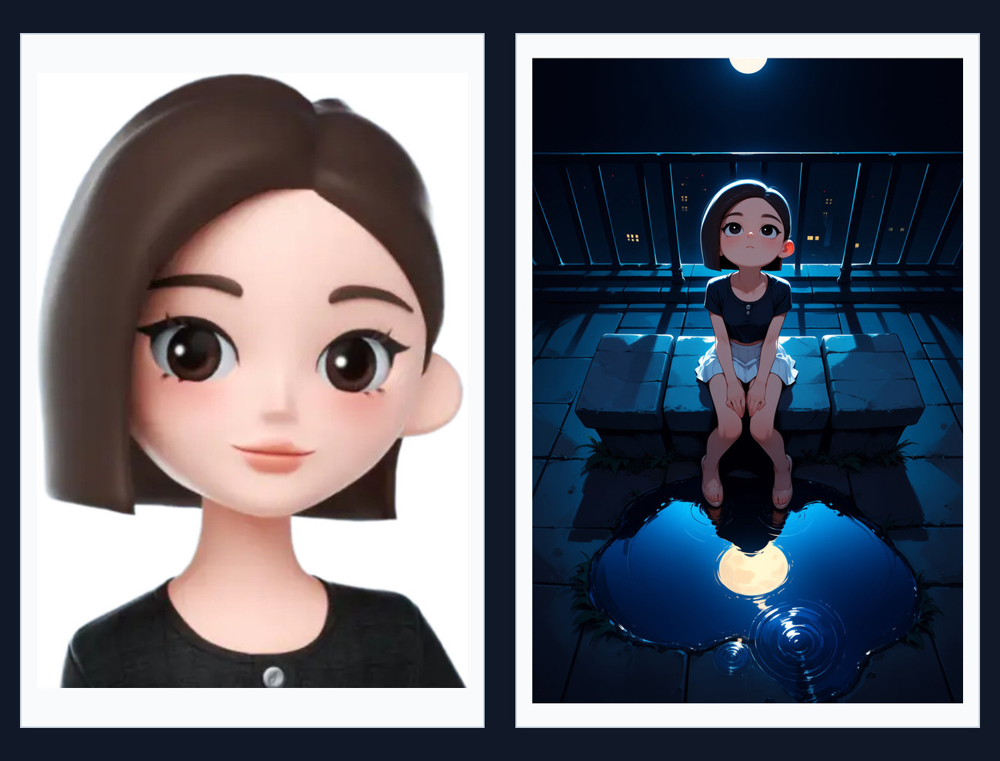

# ComfyUI Anima OmniCharacter

[English](README.md)

Anima OmniCharacter 是一个用于 Anima 的 ComfyUI 自定义节点。它从一张参考图提取单个角色的外观特征，参考图可以从头部特写到全身。

## 安装与模型准备

1. 将本仓库克隆或复制到 `ComfyUI/custom_nodes/ComfyUI-Anima-OmniCharacter`。
2. 下载 [anima_omnicharacter.safetensors](https://github.com/Einnashe/ComfyUI-Anima-OmniCharacter/blob/main/weights/anima_omnicharacter.safetensors)，放到 `ComfyUI/models/loras/` 或其他已注册的 LoRA 目录。
3. 准备 Anima 基础模型、Qwen 文本编码器和 Qwen Image VAE，放入下表对应目录。
4. 重启 ComfyUI，在节点菜单里搜索 `Apply Anima OmniCharacter`。

| 模型组件 | ComfyUI 目录 | 示例工作流中的文件名 |
| --- | --- | --- |
| Anima 基础模型 | `models/diffusion_models/` | `anima_baseV10-mid_2458426-vid_2945208.safetensors` |
| Qwen 文本编码器 | `models/text_encoders/` | `qwen_3_06b_base.safetensors` |
| Qwen Image VAE | `models/vae/` | `qwen_image_vae.safetensors` |
| OmniCharacter 角色参考权重 | `models/loras/` | `anima_omnicharacter.safetensors` |

目录均相对于 ComfyUI 根目录。若本地文件名不同，导入工作流后在对应加载节点里重新选择。自定义节点使用 ComfyUI 自带的 Python 和 PyTorch 环境。

## 准备单角色参考图

1. **选一张只包含一个角色的图。** 主要参考脸、发型或头饰时，可以用头部特写。想保留服装、配饰或整体轮廓时，选能清楚看见这些细节的半身或全身图。
2. **移除原背景，换成白背景。** 将处理后的参考图载入 `Load Image`。

## 导入并运行示例

1. 将 [示例工作流](examples/anima_omnicharacter.json) 拖入 ComfyUI 画布。
2. 在模型加载节点里确认 Anima、文本编码器和 VAE 均已选中，在 `Load Image` 里换成准备好的白底参考图。
3. 在两个文本编码节点中填写正向和负向提示词。确认 `Apply Anima OmniCharacter` 中选的是 `anima_omnicharacter.safetensors`。
4. 在 `Empty Latent Image` 设置**生成图**的宽高。示例是 `1024 × 1536`，可以按想要的取景改成其他尺寸。
5. 运行工作流。节点输出的模型和正负条件会进入 `KSampler`，采样结果经 `VAE Decode` 解码后显示在预览节点。

### 接到自己的 Anima 工作流

- 将 Anima 模型、VAE、正负文本条件和白底参考图接到 `Apply Anima OmniCharacter` 的同名输入。
- 把该节点输出的 `model`、`positive` 和 `negative` 全部接到 `KSampler` 对应接口。
- 继续用原有的 latent 输入和 VAE 解码流程。需要把预览保存成文件时，可在 `VAE Decode` 后接 `Save Image`。

显存不足时，可以缩小参考图，或关闭 `cache_reference_kv`。

## 提示词、Artist Tag 和风格 LoRA

生图提示词可直接参考 [Anima 官方提示词指南](https://huggingface.co/circlestone-labs/Anima#prompting)。

**Artist Tag 一定程度上受支持。** 在正向提示词中写 `@artist name`，把 `artist name` 换成实际的画师标签。效果会随标签和参考图而异。可参考 [Anima 提示词指南](https://huggingface.co/circlestone-labs/Anima#artist-tags)。

**风格 LoRA** 可和角色参考同时使用。用 ComfyUI 的 `Load LoRA (Model Only)` 加载与 Anima 兼容的风格 LoRA，再把它的 `MODEL` 输出接到 `Apply Anima OmniCharacter`。风格 LoRA 的强度在普通加载节点里调，角色参考强度在 OmniCharacter 节点里调。Artist Tag 和风格 LoRA 也可以同时开启；需要比较各自的效果时，可以固定种子后分别开启。

## 效果展示

左边是参考图，右边是生成图。更多对比见 [Showcase](README.md#showcase)。

## 许可与致谢

OmniCharacter LoRA 权重是 Anima 的衍生权重，适用 [CircleStone Labs 非商业许可](https://huggingface.co/circlestone-labs/Anima/blob/main/LICENSE.md)。节点实现受 [OminiControl](https://github.com/Yuanshi9815/OminiControl) 启发。
